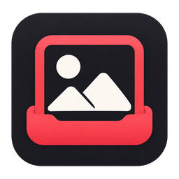

<div align="center">



# 原帧 StillDock

**小红书高清无水印素材下载工具，专注大图与 Live 动态素材。**

为 Windows 打造，使用 Rust 与内嵌 WebView2，在同一个窗口完成搜索、大图浏览、图集挑选与下载。

[下载预览版](https://github.com/hanpeiyu/stilldock/releases) · [English](README.en.md) · [构建与打包](docs/BUILDING.md) · [问题反馈](https://github.com/hanpeiyu/stilldock/issues)

</div>

## 它能做什么

- **原生搜索**：保留小红书的搜索记录、建议与登录交互。
- **专注浏览**：首页居中原生搜索框，精简无关导航，支持屏蔽点点 AI、折叠评论；随时恢复原网页。
- **同窗下载**：开始搜索时自动展开侧栏，浏览区域随窗口大小调整。
- **素材网格**：图片帖默认展开为等宽卡片，保持完整画面，支持编号、勾选、全选/反选/清空和大图预览；与右侧栏选图同步。
- **可靠队列**：图片和视频下载、暂停/继续/取消、退出恢复、本地历史及按笔记打开目录。
- **轻量分发**：HTML/CSS/JS 编译进 exe；运行不需要 Python、Node.js、.NET 或外部 Chrome。

原名“拾光 Shiguang”，自 v0.2.0 更名为 **StillDock · 原帧**。这是独立的 Rust 项目，只服务于 Windows 本地素材浏览，不包含原项目的 API、MCP、TUI 或批量作者采集端。

## 高清与 Live：实际如何保存

- **优先高清源**：从已打开笔记的媒体地址读取可用的高清候选，优先平台提供的高清 JPEG，读取保存文件的实际分辨率；不在本地二次编码。
- **不静默降质**：有高清候选时直接下载该资源，失败就提示重试；图片分辨率低于笔记标注时拒绝保存为最终文件，不自动改下低清预览图。
- **下载信息**：来源、实际像素尺寸、格式和大小统一存入 SQLite。默认不生成 JSON；需要随素材携带说明时，可选导出一份 `<任务ID>-metadata.json`。
- **Live 成组保存**：默认保存静态图片；下载按钮上方的 LIVE 开关始终可见并记忆选择，勾选后，以相同原图编号保存图片和 MP4。缩略图带 LIVE 标记，选图会同时选中对应的一组资源。
- **快捷返回**：笔记打开后左上角显示“← 返回搜索”，支持 Esc；优先使用原生关闭保留列表滚动位置，不依赖弹层周围留白。
- **大图优先**：原网页笔记信息区默认折叠，点“笔记信息”临时展开；打开笔记后侧栏回到当前笔记下载页。

“高清无水印”是下载目标，不能保证每篇笔记都暴露原始最高画质或无水印资源。平台返回的图片若已含作者嵌入水印，本程序不做抹除或修图。JPEG 资源也不等同于相机原始无损文件。Live 当前保存为图片＋MP4，不保证可直接回导为 iPhone Live Photo。

## 快速开始

1. 到 [Releases](https://github.com/hanpeiyu/stilldock/releases) 下载 Windows x64 预览版。
2. 安装包 `StillDock-<版本>-windows-x64-setup.exe` 按当前用户安装；便携包解压后运行 `xhs-browser.exe`。
3. 首次打开，在应用内完成小红书登录。搜索后打开笔记，在右侧保存整篇或勾选部分图片。

**环境**：64 位 Windows 10/11，以及 [Microsoft Edge WebView2 Evergreen Runtime](https://developer.microsoft.com/microsoft-edge/webview2/)。已安装时复用；安装包在缺少 Runtime 时联网补装。便携版需要自行准备 Runtime。应用需要联网访问小红书。

> 当前为早期预览版：未代码签名，尚未在独立 Windows 10 设备完成验证，也未完成长时间压力测试。自动化测试不能代替真实网站验收。

## 右键手势

在网页区域按住右键划动，松开后执行；方向提示和轨迹会在划动时显示。

| 方向 | 动作 |
| --- | --- |
| ← 左划 | 关闭笔记，返回搜索结果 |
| ↓ 下划 | 保存当前正在看的图片；LIVE 是否一并下载沿用开关设置 |
| → 右划 | 展开/收起下载侧栏 |

轻点右键保持原网页菜单行为。划动不足 56 CSS 像素不触发；斜划、上划、明显回折、超过 5 秒、释放在窗口外都会取消。Esc、窗口失焦或指针取消也会取消手势，Esc 不会顺带关闭笔记。输入框内或按住 Shift/Ctrl/Alt/Win 时不启用手势。

设置中可关闭“启用右键手势”。当前图片无法确认时不会猜测下载，会提示使用侧栏选图。快速保存同一笔记的不同图片可分别排队；正在排队的同一张会拦截重复添加。

## 帖子素材视图

打开图片帖后默认展示网格。点击图片卡片勾选，双击或点“放大”预览；底部下载选中的图片，LIVE 开关与右侧栏共用。预览中用 ← → 切换、下载当前一张；Esc 先关预览，再按返回搜索。图片原序号与 Live 配对沿用原有下载逻辑，高清源仍在实际下载时获取。

- 右上角“轮播视图”回到原详情；再点“素材网格”可返回。设置可关闭“帖子默认使用素材网格”，也可“显示原网页”。
- 视频帖和无法读取的帖子保留原生页面；检测到登录或验证弹窗时优先让出界面。
- 网格按可见行回收卡片，缩略图接近视口才加载；大图只按需预览一张，关闭/离开时释放图片引用和观察器。
- 布局使用 Shadow DOM 隔离网站样式。原详情暂时隐藏并禁用交互，视频暂停；返回时恢复原生关闭以保留搜索位置。原网页 DOM 仍保留，不承诺 WebView2 立刻归还全部进程内存。
- 直接打开帖子有最长一秒的原详情显示过渡保护，读取失败会放行，避免留下空白遮罩。

## 下载状态、重复文件与重试

- 卡片显示本地存在、缺失、大小变化、队列中或暂时无法访问；可筛选待下载项、选中缺失项，并点“位置”打开已有文件所在目录。勾选 LIVE 后会区分静图已存但动态片段未齐。
- 同一笔记的相同媒体默认跳过仍存在且大小匹配的文件，保留其原位置，不复制到新目录。任务保存实际文件引用；历史“打开目录”优先打开真实文件所在位置。
- 需要另存时，勾选“重新下载已有图/文件”。该选项随任务固定；恢复同一个任务时，已保存完整的项仍然跳过，避免暂停恢复造成重复。
- 下载中断、连接超时与 HTTP 500/502/503/504 最多自动重试两次，等待 0.5 秒、1.5 秒，等待期间可暂停或取消。401/403/404/410/429、磁盘与格式错误不自动循环重试。
- 媒体链接过期时重新打开帖子，程序在能确认同一媒体与原序号的情况下刷新未完成任务的地址，保留选图和 LIVE 配对；仍需主动“继续”。帖子内容被替换时不会强行匹配。
- 新下载计算完整 SHA-256 存入 SQLite，为后续内容去重准备；当前不做跨帖子自动去重，也不自动删除重复文件。日常存在性检查仍按大小进行，不保证发现等大小篡改。

查询限定同帖最近 200 个任务、最多 4000 条文件记录；超过范围的旧素材可能再次下载。文件状态后台读取，使用来源索引、有界请求队列，并在任务状态或文件数量变化时刷新，避免随每次进度更新扫描文件。

## 本地文件被移动或删除

下载成功的历史与本地文件状态分开显示。启动、打开帖子、进入历史页时后台核对记录中的文件；历史页也可手动“核对本地文件”。检查存在性和字节大小，不读取全部图片或扫描磁盘，最多核对最近 200 个已完成任务。

- 缺失或大小变化：点击当前帖子或历史任务中的“补下缺失 / 异常项”，跳过仍正常的文件，沿用原目录与保存设置。
- 整理到其他文件夹：历史任务点“关联新目录”，选择素材实际所在文件夹；按原文件名和大小全部匹配后，原子更新路径，不复制或移动素材。此匹配不等于内容哈希校验；改过文件名或只移动了一部分时不会关联。
- 磁盘离线或权限不足：显示“暂时无法访问”，不自动当作删除或补下。
- 检查不会删除下载历史或自动下载；重新下载需要平台资源仍可访问。相同大小的内容修改不在本轮快速检查范围内。

## 数据与隐私

| 内容 | 默认位置/行为 |
| --- | --- |
| 登录会话、设置与任务库 | `%LOCALAPPDATA%\XhsBrowserRust` |
| 下载文件 | `%USERPROFILE%\Downloads\XHS\<笔记ID>\`（可改为直接平铺） |
| 本地任务数据库 | 数据目录下 `library.sqlite3` |
| 笔记信息 | SQLite；JSON 说明文件默认关闭 |
| 卸载 | 保留登录数据和已下载文件 |

沿用此前 Rust 预览版的数据目录及可执行文件名，方便已有用户直接升级。便携版仅指无需安装，登录数据仍写入上述本机目录。

程序不读取日常 Chrome 的 Cookie，不导出 Cookie 到任务库，也不设置遥测或本地 HTTP 服务。登录由内嵌 WebView2 管理。可选导出的 JSON 与任务库包含标题、作者和带访问参数的链接，反馈问题时请勿上传整个数据目录。

在“设置 → 保存方式”选择“按笔记分子目录”或“直接保存到所选目录”。按笔记模式不再额外建立任务子目录，补选放入同一笔记文件夹；平铺文件名含标题、笔记 ID 和图片序号。同名文件自动另存，不覆盖已有素材；跨任务内容去重尚未实现。

任务创建时固定目录和 JSON 导出选项，后续修改仅影响新任务；旧任务继续使用原目录和临时文件，不移动素材，也不自动删除旧 JSON。续传缓存按任务隔离，临时位于输出目录下的隐藏 `.stilldock-cache`，完成后清理空缓存目录。

## 已知边界

- 网站结构变化可能影响搜索精简和媒体解析，可先切换“显示原网页”排查。
- 仅保存当前账号有权查看的笔记；不会绕过登录、验证码或平台访问限制。
- 高清源和实际尺寸取决于平台提供的资源；不可用时提示失败，不静默降质。无法保证为相机原始文件或不存在作者嵌入水印。
- 历史界面保留所有进行中的任务，并展示最近 200 条已完成/取消记录；不是全库搜索。
- 已过期媒体链接可能需要重新打开笔记后创建下载任务。
- 仅 Windows x64；不包含 macOS、Linux、移动端和自动更新。

## 开发与发布

需要 Rust stable MSVC、Visual Studio C++ Build Tools、Windows SDK；页面单元测试还需要 Node.js 22 或更新版本。Node.js 仅用于开发。

```powershell
git clone https://github.com/hanpeiyu/stilldock.git
cd stilldock
cargo fmt --check
cargo test --locked
node --test tests/site.test.cjs tests/panel.test.cjs tests/search.test.cjs tests/bootstrap.test.cjs tests/focus.test.cjs tests/navigation.test.cjs tests/gestures.test.cjs tests/materials.test.cjs
cargo build --release --locked
```

入口为 `src/main.rs`。详见 [构建与打包](docs/BUILDING.md)、[架构说明](docs/ARCHITECTURE.md)、[更新记录](CHANGELOG.md) 和 [后续计划](docs/ROADMAP.md)、[验证记录](docs/VALIDATION.md)。GitHub Actions 在 Windows 上运行格式检查、Rust/页面测试及发布构建；手动构建可下载安装包和便携包工件。

## 来源与许可

GPL-3.0-only，见 [LICENSE](LICENSE) 和 [NOTICE.md](NOTICE.md)。本项目从 [hanpeiyu/XHS-Downloader](https://github.com/hanpeiyu/XHS-Downloader) 工作区中的 Rust 浏览器实验独立而来；媒体提取与网页适配参考并延续 [JoeanAmier/XHS-Downloader](https://github.com/JoeanAmier/XHS-Downloader) 及其衍生工作区的成果。感谢原项目作者和贡献者。

本项目与小红书官方无隶属关系。请尊重内容作者权益，仅保存有权使用的内容。重新分发程序时应按 GPL 提供相应源码及许可说明。
